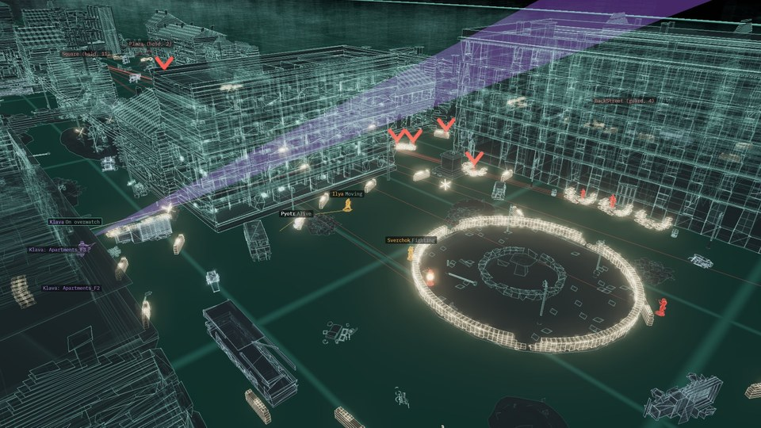

## Hi, I'm Tony 👋

By day I'm an engineer at an advanced nuclear reactor startup. I'm also a dad, so most of what's here gets built in the gaps.

### Building now

| [**Domoy**](https://github.com/CoderofVibes/Domoy-DevLog) | [**Cerebro**](https://github.com/CoderofVibes/Cerebro) |
|---|---|
|  |  |
| A single-player, story-led first-person game set during the Battle of Stalingrad, made solo in Unreal Engine 5 and Blender. | A 3D replay and analysis lab for simulated combat. Every playtest comes back as a hologram you can scrub, inspect and ask questions of. |

Along the way I've built my own tooling too: an MCP bridge so AI can drive the Unreal editor, and a pile of build and check scripts.

### Also

- **Shear Logic:** my lineup of small engineering apps for iPhone and iPad, like Numerist and MixerSim.
- **Hackathons:** how I have fun. A weekend, a team, an idea, and seeing how far we get before the clock runs out.

I work closely with AI tools and I'm big on automating anything I'd otherwise do twice. Slow progress is still progress.

### Find me

[X @CoderofVibes](https://x.com/CoderofVibes) · [Domoy dev log](https://github.com/CoderofVibes/Domoy-DevLog) · [Cerebro](https://github.com/CoderofVibes/Cerebro)
